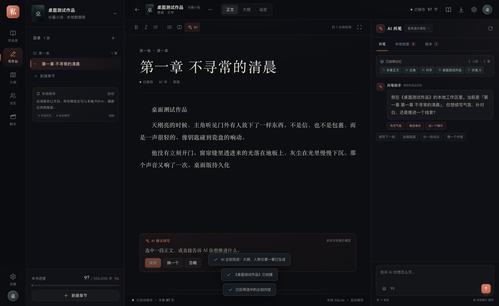
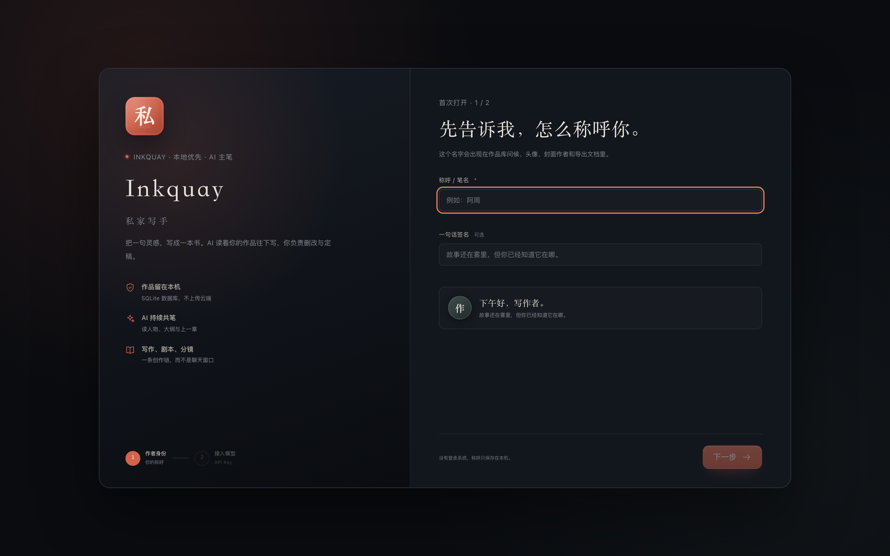
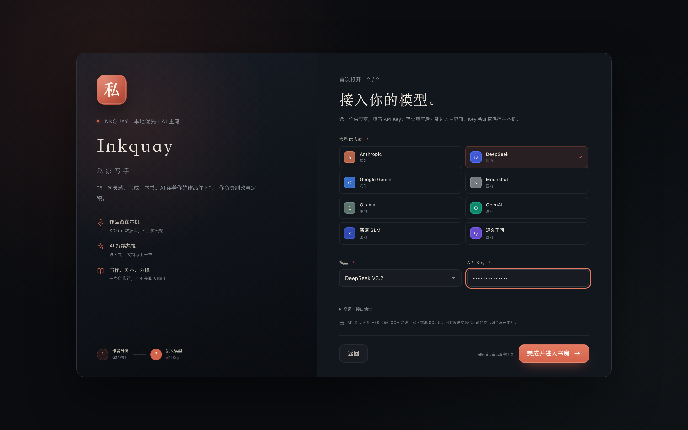
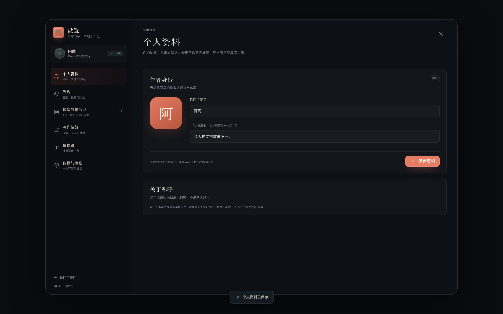
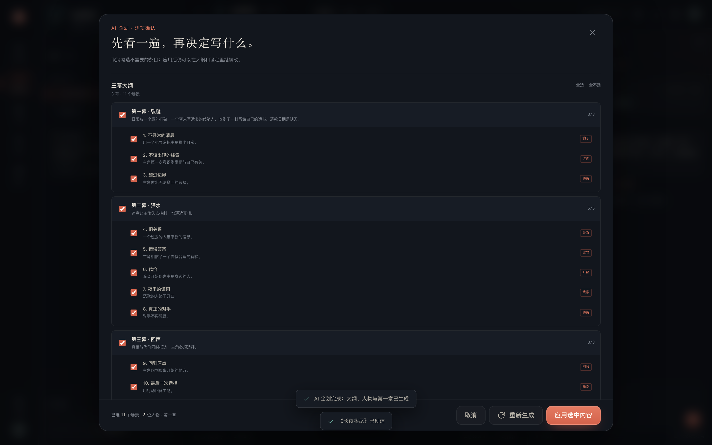
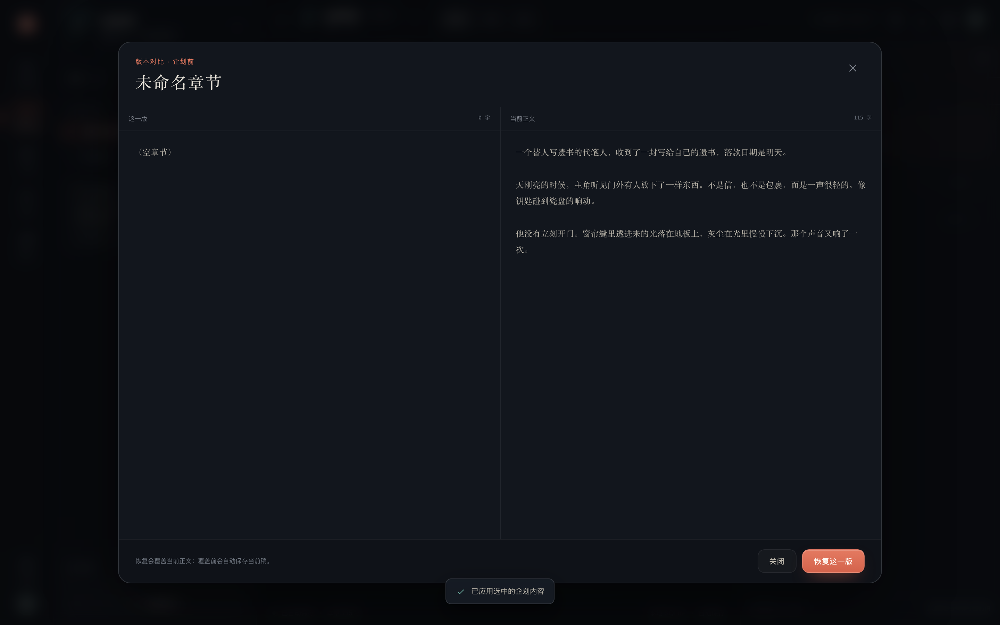
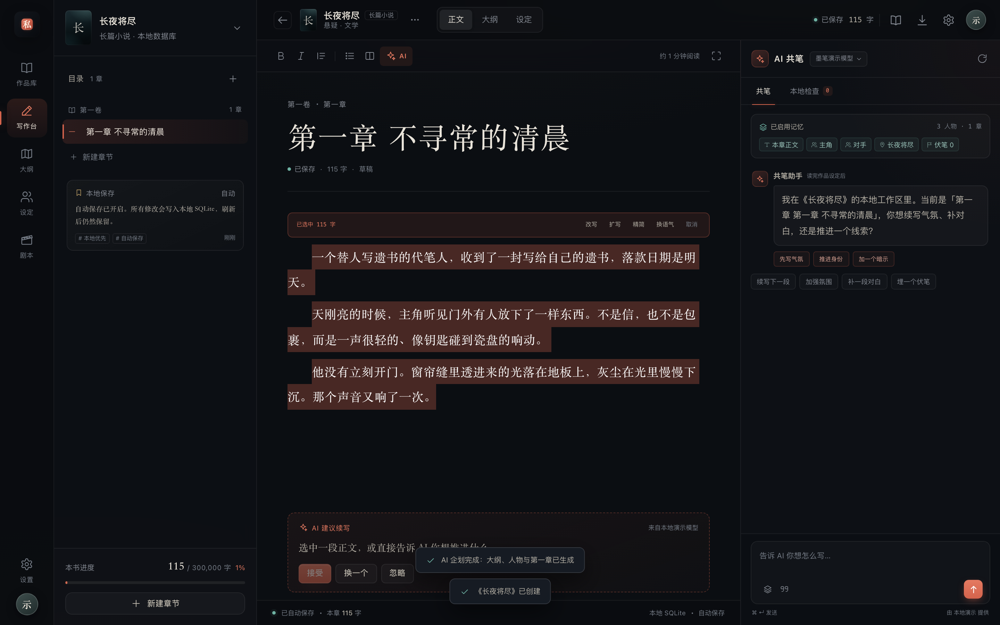
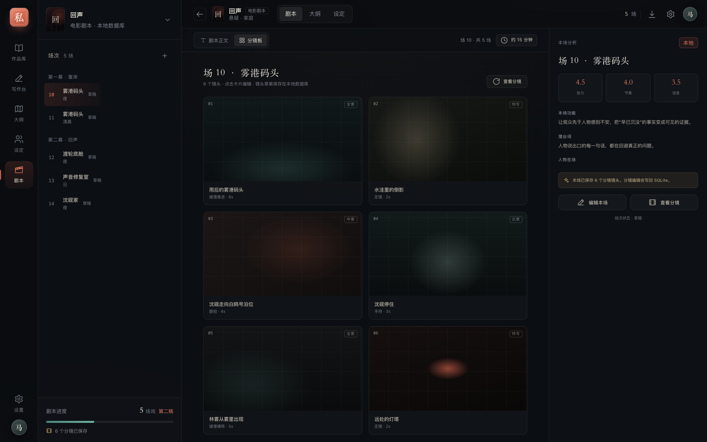

# Inkquay · 私家写手

[](https://github.com/maliang/Inkquay/actions/workflows/release.yml)

> **Inkquay** = Ink + Quay（墨水与码头）。一个安静的私人写作码头，给长篇故事和它们的作者。中文名仍是「私家写手」。


Inkquay（私家写手）是一个面向中文长篇小说、短篇小说与剧本作者的本地优先创作软件。目标不是「一键生成」，而是让作者始终掌握结构、人物、伏笔和文风：**AI 负责共笔与检查，作者负责判断。**

根目录现在是**全栈应用入口**；早期静态界面原型归档在 [`prototype/`](prototype/README.md)，不再作为主产品。

## 快速开始

```bash
# 安装依赖（只需一次）
pnpm -C software install

# 开发版
pnpm dev
```

- Web：**http://127.0.0.1:5180**
- API：http://127.0.0.1:8787
- 首次打开会强制填写 **称呼 + API Key**，不完成不能进入主界面
- 没有演示作品；安装后从空书房开始

生产构建：

```bash
pnpm build
pnpm start          # 默认 http://127.0.0.1:8787
```

也可以直接进入 [`software/`](software/README.md) 使用同样的命令。

## 首次启动

安装后第一次打开会进入两步引导，不能跳过：

1. **作者身份**：填写称呼 / 笔名，可选一句话签名。
2. **接入模型**：选择供应商、模型并填写 API Key；Ollama 本地模型可免 Key。

完成后才会进入主界面。称呼与签名会写入本地 SQLite，并用于问候、头像、封面作者和导出署名；API Key 加密保存。之后可以在「设置 → 个人资料 / 模型与供应商」修改。

Logo 为矢量 SVG：`software/public/logo.svg`，桌面图标也由它生成。

## 自动发布与升级

GitHub 仓库：[maliang/Inkquay](https://github.com/maliang/Inkquay)

- 推送到 `main` 自动触发 [Release Inkquay](.github/workflows/release.yml)，自动发布到 [GitHub Releases](https://github.com/maliang/Inkquay/releases/latest)
- 版本号：`0.1.<GitHub Run Number>`，自动生成 DMG + ZIP + `latest-mac.yml`
- 产物发布到 GitHub Releases；首次安装从 Releases 下载
- 应用启动后会检查更新，之后每 4 小时检查一次
- 发现新版本弹窗：点「更新并重启」→ 自动下载 → 下载完成自动重启安装
- macOS 菜单「检查更新…」可手动检查
- 开发版不检查更新
- 已验证：打包版启动 8 秒后检测到 GitHub 最新版；点击「更新并重启」会进入自动下载/安装流程

> macOS 的 Squirrel 自动更新要求 App 被签名。GitHub Actions 默认构建未签名版本（可通过 Release 手动安装）；要启用真正的自动升级，请在仓库 Secrets 配置 `CSC_LINK` / `CSC_KEY_PASSWORD`，并在需要时补 notarization。配置后 workflow 会自动签名；未签名版本的下载失败会回退到打开 Releases 下载页。

## 桌面版（macOS）

已经打包成独立 `.app` 和 `.dmg`，不需要用户安装 Node：

```bash
pnpm desktop         # 直接启动桌面版
pnpm desktop:pack    # 生成 desktop/release/mac-arm64/Inkquay.app
pnpm desktop:dmg     # 生成 desktop/release/Inkquay-0.1.0-arm64.dmg
```



- 数据：`~/Library/Application Support/Inkquay/data/studio.db`
- 日志：`~/Library/Application Support/Inkquay/logs/server.log`
- 已实测：启动、编辑、关闭、重启后内容保留
- 当前只构建 macOS arm64；未做签名 / notarization，首次打开可能需右键 → 打开
- 详细说明：[desktop/README.md](desktop/README.md)

## 当前进度

**Milestone 8 · Inkquay + AI 企划逐项确认 + 版本回退 + 桌面版**

- 无演示数据；首次启动强制填写称呼与 API Key
- 作品库、新建作品、空书房引导、作品设置、归档、级联删除
- 章节树、正文编辑、800ms 自动保存、字数统计
- AI 企划：一句灵感 → 预览 → 逐项确认 → 三幕大纲 / 人物 / 第一章
- 章节版本：AI 企划 / 插入 / 改写自动快照，左右对比与回退
- AI 流式共笔、重新生成、消息持久化、插入正文、模型切换
- 选中文本 → 改写 / 扩写 / 精简 / 换语气 → 替换选中
- 模型供应商：OpenAI 兼容 / Anthropic / Gemini / 本地 mock
- 供应商 Key 使用 AES-256-GCM 加密保存
- 大纲场景编辑 / 新增 / 上移下移 / 拖拽排序 / 删除
- 人物 CRUD、伏笔新增/编辑
- 剧本场次编辑 / 新增
- 分镜板：每场生成 6 个模板镜头，可编辑并持久化
- 个人资料：称呼 / 笔名、签名、头像首字，贯穿问候与导出署名
- 四套主题、六种强调色、自定义颜色、字号与动效
- Markdown / Word（.docx）导出
- macOS 桌面版：独立 `.app` / `.dmg`，内置本地服务，不依赖系统 Node
- 隔离 SQLite 的 API 集成测试 + Playwright 浏览器 E2E + Electron 桌面 E2E
- AI 企划先生成预览，支持逐项勾选/取消后再写入；失败不会丢作品

## 界面截图

> 以下截图中的作品为开发验收时的示例数据；正式安装没有演示作品，会从空书房开始。

| 首次启动 · 作者身份 | 首次启动 · 接入模型 |
| --- | --- |
|  |  |

| 空书房 | 个人资料 |
| --- | --- |
|  |  |

| AI 企划：逐项确认 | 生成版本对比 |
| --- | --- |
|  |  |

| 选中文本改写 |
| --- |
|  |

| 分镜板 | macOS 桌面版 |
| --- | --- |
|  |  |

## 架构

```text
私家写手/
├── software/                 # 全栈应用
│   ├── src/client/           React 19 + Vite 8
│   ├── src/server/           Express 5 + node:sqlite
│   ├── src/shared/           前后端共享类型
│   ├── data/                 SQLite / 本地密钥（运行时生成）
│   ├── public/logo.svg       矢量 Logo
│   └── scripts/              API 测试 / UI E2E
├── desktop/                  # Electron 桌面壳（macOS .app/.dmg）
├── prototype/                # 早期静态界面原型（归档）
└── package.json              # 根入口 / 桌面打包脚本
```

- 前端：React Router 7，复用原型 CSS 设计系统
- 后端：Express 5，SSE 流式输出
- 数据库：Node 内置 `node:sqlite`，WAL 模式
- 密钥：`software/data/.secret` + AES-256-GCM

## 测试

```bash
pnpm typecheck
pnpm test       # API 集成测试：临时目录 + 独立 SQLite
pnpm test:ui    # 构建后用独立 SQLite 启动生产服务，跑 Playwright
pnpm desktop:test  # 启动 Electron，验证编辑 → 关闭 → 重启后数据保留
```

覆盖首次初始化（强制称呼 / API Key）、作品、章节、自动保存、总字数、大纲、人物、伏笔、剧本、分镜、设置、供应商 Key、AI SSE 与重新生成、Markdown/Word 导出、作品删除级联。

## 已知边界

- 分镜生成是模板草案，尚未接视觉模型
- 大纲跨幕拖拽暂未开放
- 富文本编辑器仍是 contentEditable
- 暂无账号系统、多用户、云同步；称呼和 API 只是本地设置
- AI 企划已支持逐项确认，章节版本可对比回退
- 还没有跨章节的版本总览与分支版本
- 桌面版当前只构建 macOS arm64，未签名 / notarization
- 静态原型已归档，但还没有正式删除

更详细的工程说明见 [software/README.md](software/README.md)。
