# 私家写手 · 静态界面原型（已归档）

> **归档说明**：本目录是早期高保真静态原型，不再作为主产品。全栈版位于 [`../software/`](../software/README.md)；仓库根目录运行 `pnpm dev` 后打开 http://127.0.0.1:5180。

> 本目录仍可用 `python3 -m http.server` 单独预览，仅作设计存档。

一个面向中文长篇小说、短篇小说与剧本作者的 AI 创作工作台高保真界面原型。目标不是「一键生成」，而是让作者在长篇写作中始终掌握结构、人物、伏笔和文风：AI 负责共笔与检查，作者负责判断。

> 当前为纯前端交互原型，全部内容为演示数据；AI 回复为流式模拟，未接入真实模型。

## 快速预览

```bash
cd "/Users/maliang/Documents/develop/maliang/私家写手"
python3 -m http.server 4173
# 打开 http://127.0.0.1:4173/
```

无需安装依赖、无需构建。建议使用 1440×900 或 1280×800 的桌面浏览器窗口。

## 界面导览

| 界面 | 说明 | 截图 |
| --- | --- | --- |
| 作品库 | 今日写作数据、续写入口、作品卡、体裁模板、创作动态与灵感胶囊 | 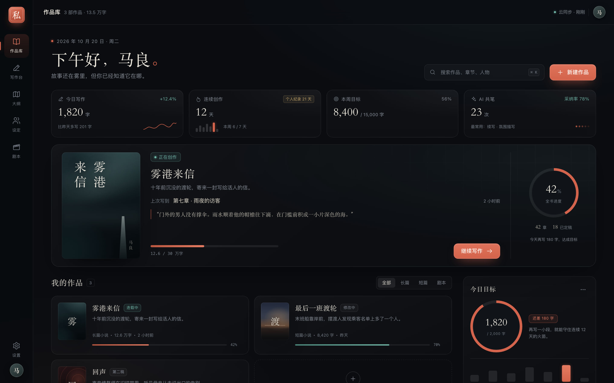 |
| 写作台 | 目录 + 正文编辑器 + AI 共笔三栏；章节切换、批注、AI 续写插入、连续性检查 | 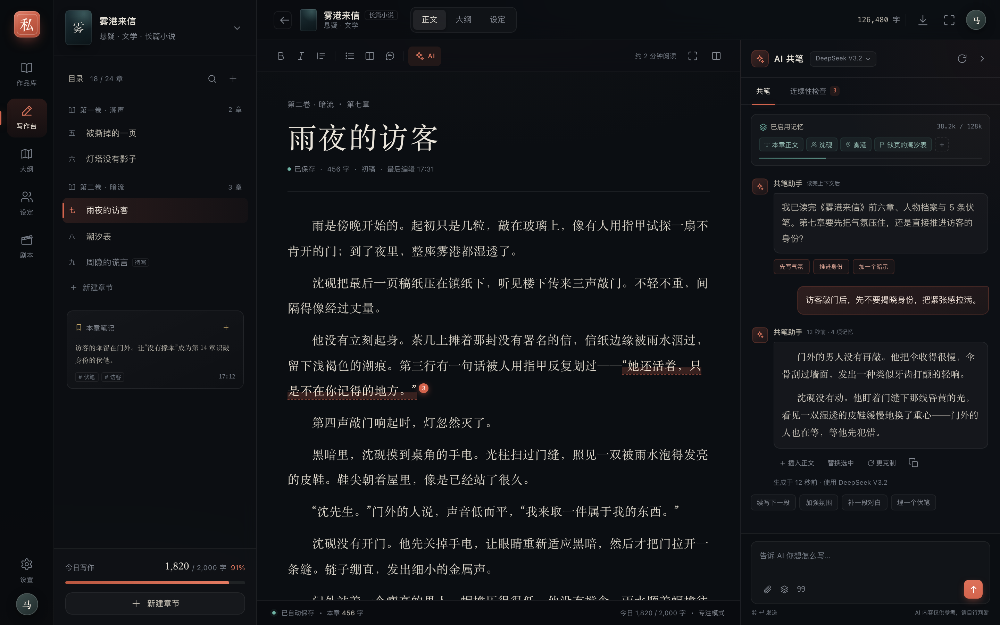 |
| 故事大纲 | 情绪张力曲线、章节诊断、三幕 beat 卡片 | 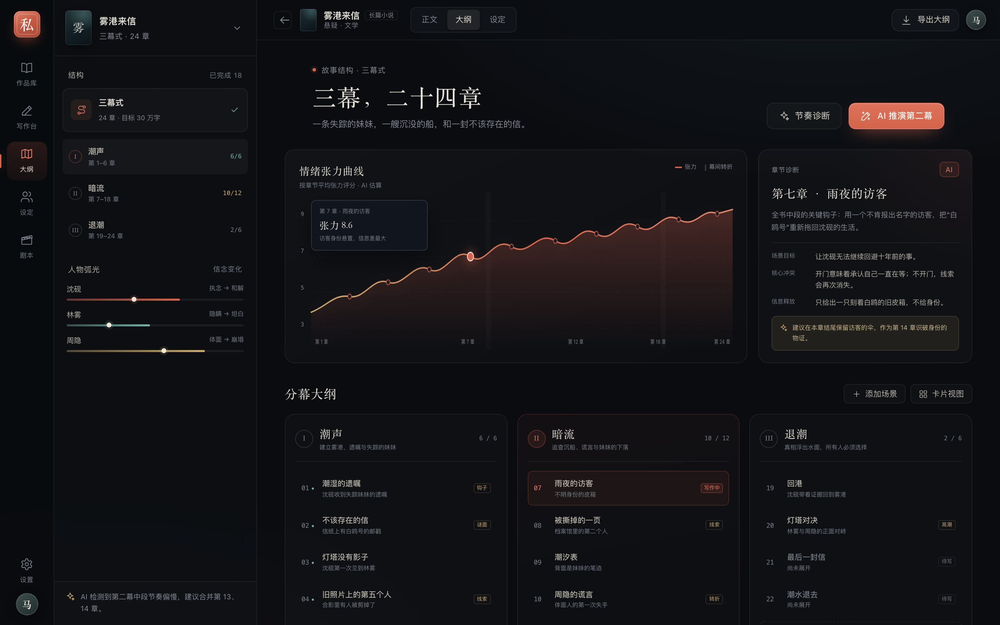 |
| 人物设定 | 人物 / 地点 / 组织 / 道具 / 时间线 / 伏笔；AI 长期记忆索引 | 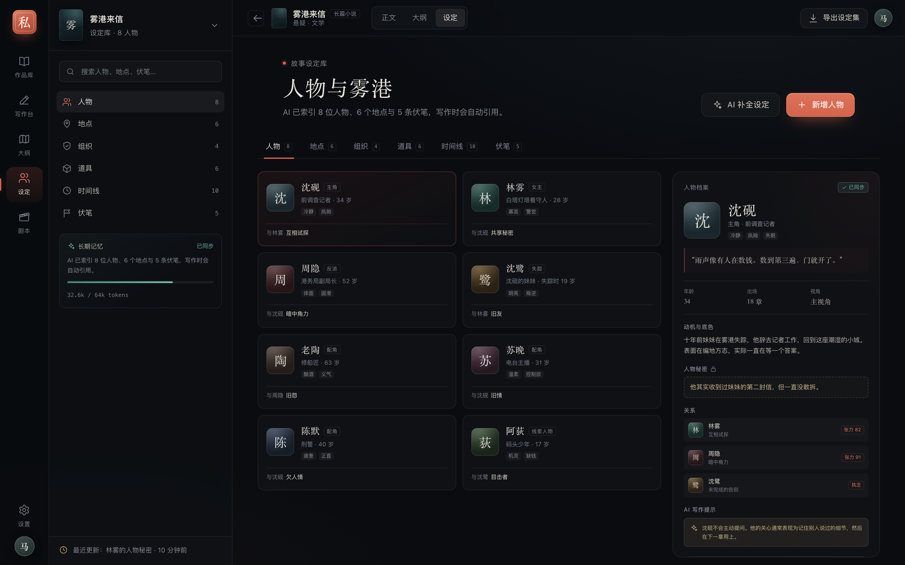 |
| 剧本工坊 | 场次表、标准剧本排版、场次分析、AI 分镜板 | 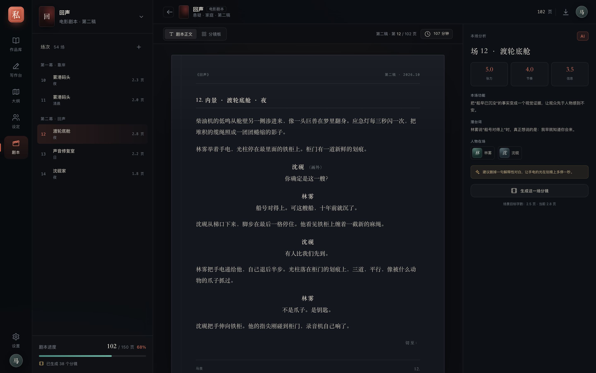 |
| 新建向导 | 体裁与灵感 → AI 创作方案（标题/人物/三幕）→ 开始写作 | 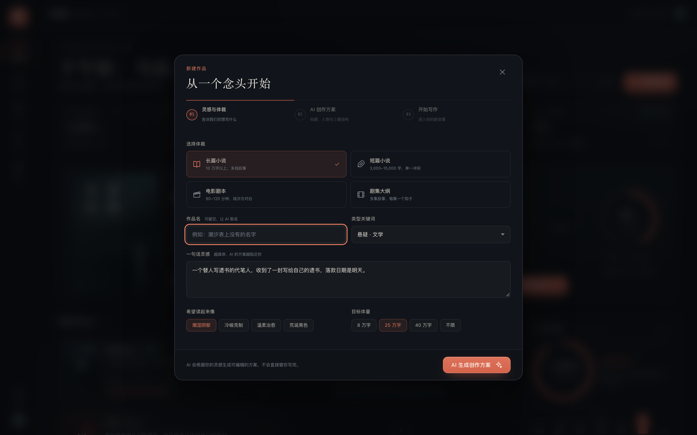 |
| 设置 · 外观 | 4 套主题、6 种主题色 + 自定义色、正文字号、减弱动效 | 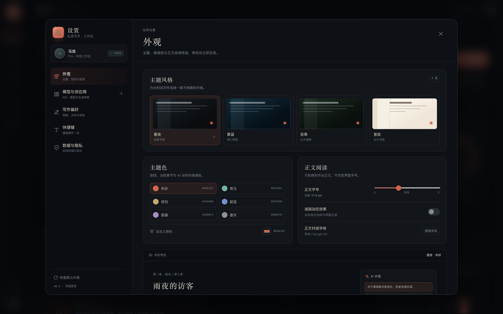 |
| 设置 · 模型 | 8 个内置供应商、连接状态、模型列表、默认/备用模型 | 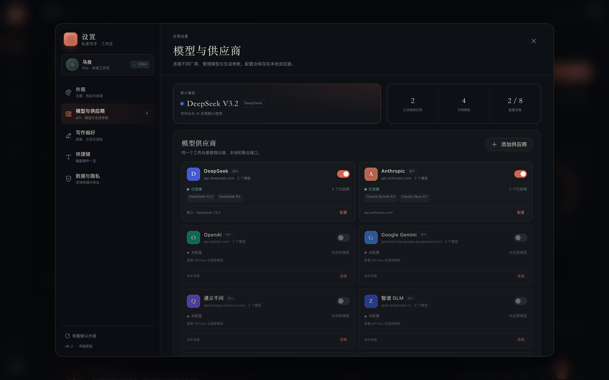 |
| 供应商配置 | API Key、Base URL、检查连接、模型勾选与星标 | 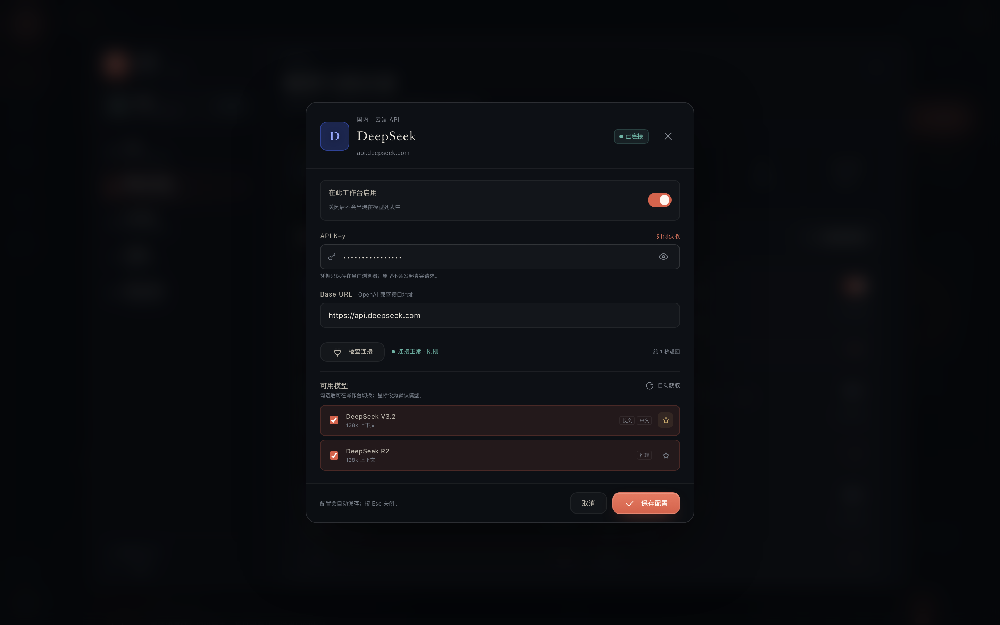 |
| 宣纸主题 | 四套主题中的浅色模式；进度环、卡片与正文全部适配 | 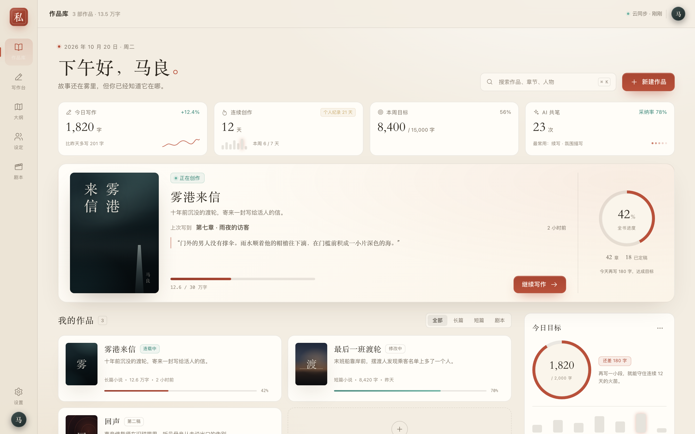 |

更多截图见 `screenshots/`。

## 已实现的交互

**作品库**
- 作品卡打开对应项目（长篇 → 写作台，剧本 → 剧本工坊）
- 全部 / 长篇 / 短篇 / 剧本筛选，作品标题、章节名、人物名均可搜索（⌘K 聚焦）
- 搜索无结果时显示空状态与「清除搜索」，不再只剩一张新建卡
- 继续写作直达《雾港来信》第七章；作品卡「更多」菜单可用 Esc 关闭
- 模板卡打开新建向导，同时预填对应体裁的灵感、类型、语气与体量

**写作台**
- 章节树切换，正文与标题可直接编辑，字数 / 阅读时长实时更新
- 工具栏加粗、斜体、引用、列表、场景分隔
- 正文中的批注下划线可点开批注浮层
- AI 共笔：快捷提示 / 自由输入、流式输出、插入正文、更克制、复制
- 记忆上下文条、模型切换、连续性检查（3 条示例问题，底部固定检查范围）
- 新建章节会先保存当前章，再创建正确的卷 / 章号，不复制旧正文；本章笔记随章节切换
- 专注模式（⌘. 或工具栏进入，Esc 退出），⌘K 会自动退出专注模式
- AI 面板会随当前作品切换欢迎语、记忆 chips、快捷动作与语气示例

**故事大纲**
- 点击 24 章 beat 卡片切换右侧「章节诊断」
- 张力曲线、tooltip 位置与选中章节联动，补充 y 轴刻度
- 侧栏三幕可点击定位到对应分幕；节奏诊断 / AI 推演第二幕有明确反馈

**人物设定**
- 8 位人物卡与右侧档案联动，档案栏独立滚动
- 地点、组织、道具、时间线、伏笔五个子库
- 设定搜索跨 tab 生效，无结果时显示空状态，AI 写作提示

**剧本工坊**
- 5 个场次切换，标准剧本排版（场景标题 / 动作 / 角色 / 对白 / 切至）
- 剧本正文 ↔ 分镜板切换，分镜板标题、镜头与场次同步
- 每场 AI 分析：张力 / 节奏 / 信息量、本场功能、潜台词、建议
- 6 格分镜草案，modebar 常显当前页 / 总页数

**新建向导 / 导出**
- 四类体裁、类型关键词、一句话灵感、语气与体量；loading 期间按钮禁用
- AI 生成中状态 → 标题 / logline / 主要人物 / 三幕结构方案
- 方案可换标题与故事方向、返回修改；创建完成态标题与用户输入一致
- 「进入写作台」会真正创建项目卡、第一章与可编辑空白稿，并进入写作台
- 作品导出弹窗（Word / PDF / Markdown / TXT，正文或大纲+设定）

**设置中心**
- **外观**：墨夜 / 雾蓝 / 苔青 / 宣纸四套主题，切换立即生效；6 种预设主题色 + 自定义取色，深色与浅色主题各用一套明度变体
- **阅读**：正文字号 15–22px 实时预览，减弱动态效果；设置只影响写作台正文
- **模型与供应商**：8 个内置供应商（DeepSeek / Anthropic / OpenAI / Gemini / 通义 / 智谱 / Moonshot / Ollama），可再添加 OpenRouter、Azure OpenAI、vLLM、LM Studio 或自定义 OpenAI 兼容接口
- **供应商配置**：启用开关、API Key 显示/隐藏、Base URL、检查连接（成功/失败/检查中）、模型勾选、星标默认模型、自动获取模型
- **模型联动**：默认模型 / 备用模型 / 创造性 / 流式输出；切换后 AI 面板模型名、模型菜单与新消息元信息同步
- **持久化**：外观、供应商配置、写作偏好写入 localStorage；刷新后保留，数据页可导出设置或一键清除
- **写作偏好**：视角、体裁、AI 续写长度、自动保存、AI 文风；快捷键页集中展示键位
- **交互参考**：LobeHub 的「外观 = 主题 + 强调色 + 字体 + 动效」与「供应商 = 开关 + Key + Base URL + 检查 + 模型列表」，以及 Cherry Studio 的「多供应商 / 多模型聚合工作台」形态

## 设计说明

- **气质**：深夜书房 + 墨港雾气。近黑蓝底、暖白文字、朱砂强调，中文衬线标题（宋体）与无衬线 UI 混排。
- **信息密度**：写作台保持三栏高密度，但正文栏留出 720px 阅读宽度和 2.0 行高；AI 面板承担「工作记忆」而不是聊天玩具。
- **色彩语义**：朱砂 = 当前 / AI 动作；青玉 = 已同步 / 健康状态；金色 = 伏笔 / 提示。避免大面积高饱和。
- **组件**：统一 4/8/12/16 间距体系，卡片 10–18px 圆角，细边框 + 低对比渐变，不使用重阴影。
- **主题系统**：颜色通过 CSS 变量驱动，包括强调色 RGB、页面/面板/纸张表面、正文尺寸；深渊/苔青只改环境色，宣纸主题额外覆盖卡片、AI 气泡、剧本纸面与图表网格。
- **无外部资源**：图标、封面、分镜画面全部为内联 SVG / CSS 渐变，离线可跑。

## 质量验收

项目经过两轮独立评审，报告与可复现脚本均保留在仓库内：

| 报告 | 结论 | 产物 |
| --- | --- | --- |
| [交互 QA](qa/interaction-report.md) | 测试时 P0×1 / P1×5 / P2×18；本轮已修复 P0 与全部 P1，以及多数 P2 | `qa/pw/`、`qa/logs/`、`qa/shots/` |
| [视觉与产品评审](qa/visual-report.md) | 7.5 / 10；本轮压缩首屏、提高小字对比度、加宽 AI 面板、补空状态与坐标轴 | `qa/metrics-visual.json`、`qa/shots-visual/` |

本轮修复后的复测结果：

- 控制台 0 error / 0 pageerror；1440、1280 均无横向溢出。
- 新建章节不再复制旧正文，返回原章节内容保留。
- 作品卡「更多」、向导创建项目、AI 流式操作区、分镜场次同步、跨作品上下文均已修复。
- 搜索空状态、Esc 关闭浮层、焦点陷阱、设定搜索跨 tab 等交互已补齐。
- 设置中心新增复测：四套主题切换、自定义主题色、正文字号、供应商配置/检查连接/模型星标、默认模型联动 AI 元信息、刷新持久化、清除本地偏好；1440 / 1280 无横向溢出，控制台 0 error。

## 文件结构

```
.
├── index.html              # 五视图 + 弹窗 + SVG 图标库
├── styles.css              # 设计系统、布局、响应式
├── app.js                  # 数据、渲染、交互、AI 流式模拟
├── screenshots/            # 关键界面截图
├── scripts/capture.cjs     # Playwright 截图脚本
├── qa/                     # 独立 QA 与设计评审报告、复现脚本
└── README.md
```

更多状态截图：

| 搜索空态 | AI 连续性检查 | 新建项目后的空白稿 |
| --- | --- | --- |
| 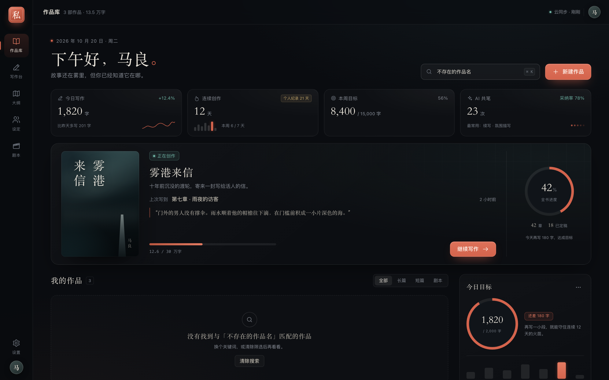 | 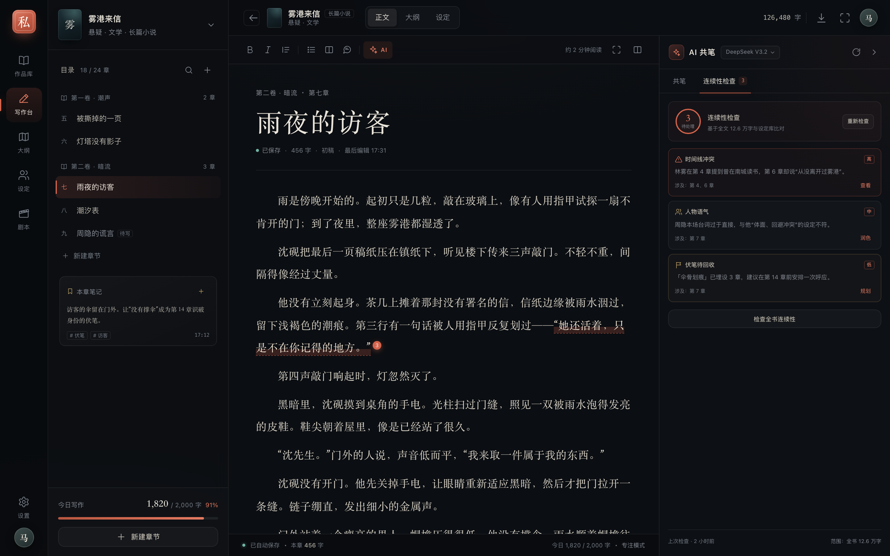 | 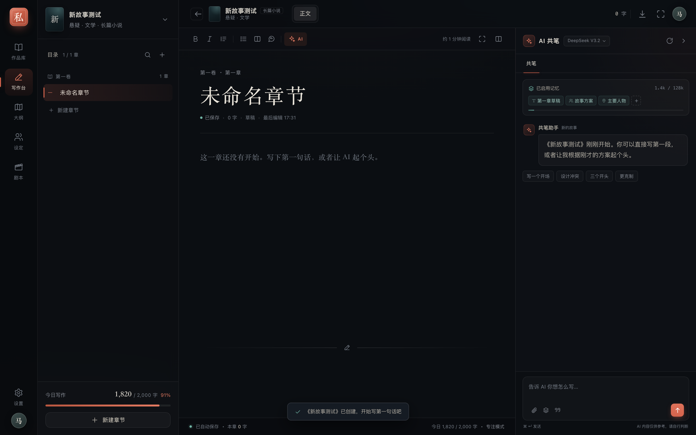 |

重新生成截图（需 Playwright）：

```bash
NODE_PATH=/tmp/pw/node_modules node scripts/capture.cjs
```

## 原型边界

- 作品与章节内容仅存在内存中，刷新后恢复演示内容；外观、供应商与写作偏好保存在当前浏览器的 localStorage。
- 供应商 Key 仅保存在本机浏览器，原型不会发起真实网络请求；「检查连接 / 自动获取模型」为本地模拟。
- 没有后端、账户系统与多设备同步；设置导出不包含真实密钥。
- AI 生成、连续性检查、导出、分镜生成均为交互演示，不代表真实模型能力。
- 桌面优先；1024px 下工具栏、人物卡与作品进度存在挤压，尚未提供完整平板 / 移动端导航。
- 短篇与新项目目前只开放「正文」，大纲 / 设定会明确提示暂未启用，不会静默切换到其他作品。
- 新建的剧本类型项目会创建空白稿并进入写作台，但尚未生成独立场次表。
- 剧本正文目前只读排版，不可直接编辑；分镜为 CSS 占位画面，不是真实生成图像。

## 设置交互参考

- [LobeHub · 界面外观](https://lobehub.com/zh/docs/usage/user-interface/appearance)：主题模式、强调色、字体与动效的拆分方式。
- [LobeHub · 使用模型服务商](https://lobehub.com/zh/docs/usage/providers)：供应商启用开关、API Key、Base URL / 代理、检查连接与模型启用列表。
- [Cherry Studio](https://cherryai.com/)：把多家供应商与多模型聚合到一个桌面工作台的产品形态。

## 建议的下一步

1. **接入真实模型与长上下文**：章节摘要、人物卡、伏笔台账分层注入，显示 token 预算与引用来源。
2. **把「记忆」做成可编辑对象**：作者可以锁定 / 删除某条设定，AI 续写必须引用来源，避免长篇漂移。
3. **真正的剧本工作流**：场次拖拽、角色对白统计、分镜导出、剧本 PDF 模板。
4. **持久化与版本**：IndexedDB / 云端草稿、章节历史版本、AI 采纳记录。
5. **模型密钥安全**：正式版使用系统钥匙串 / 本地加密存储，并提供代理服务，避免把 Key 暴露在 localStorage。
6. **移动端与专注写作**：手机速记、离线写作、打字机模式与目标提醒。
