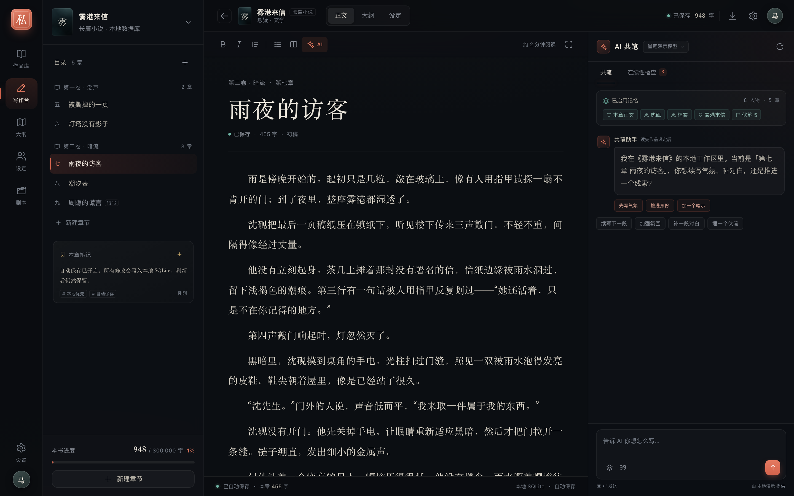
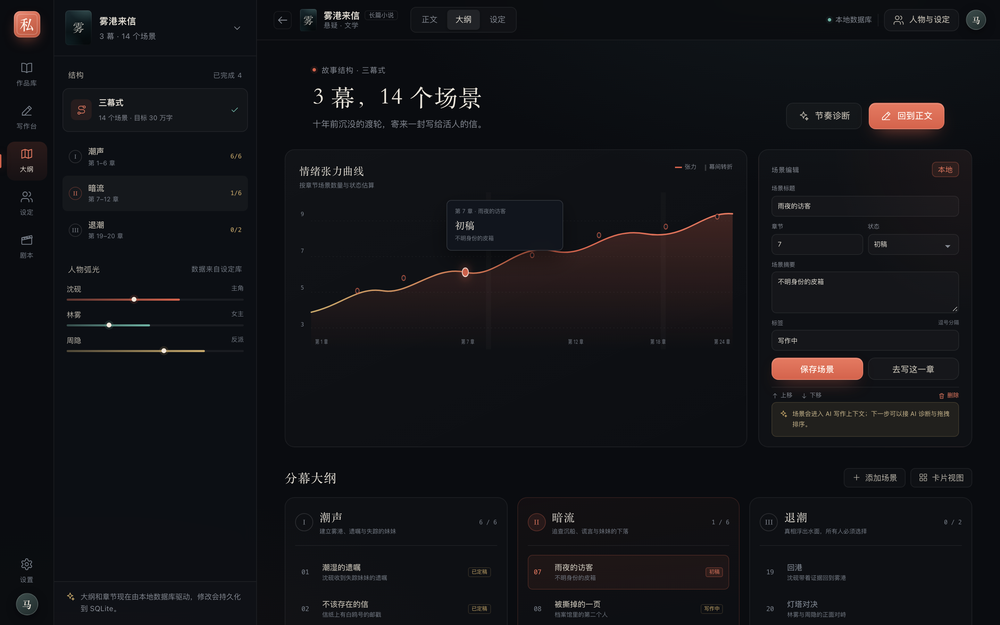
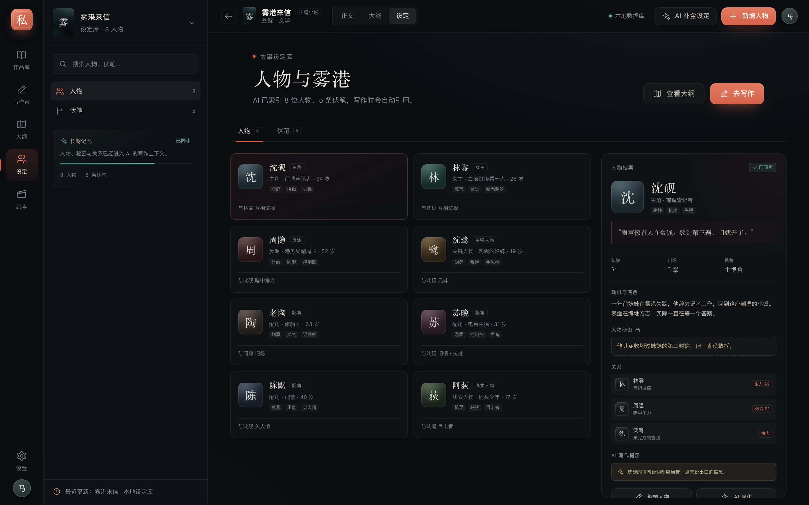
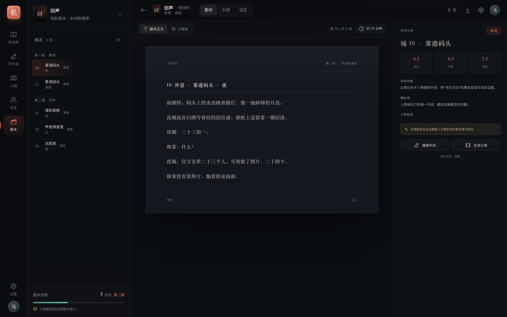
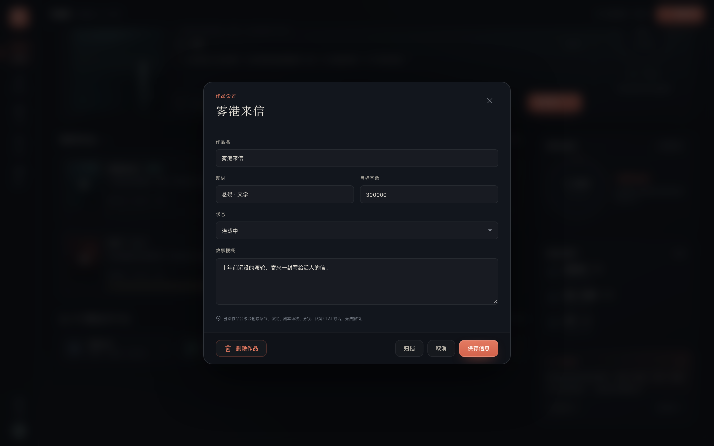
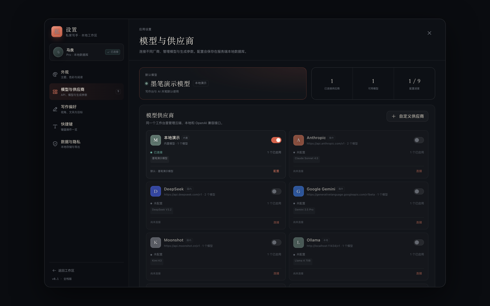

# Inkquay · 私家写手 · 全栈开发版


**Inkquay（私家写手）**：本地优先的 AI 长篇 / 短篇 / 剧本创作工作台。

当前为 Milestone 12（长线写作与发布验收）：作品库、写作台、真实 SQLite 持久化、自动保存与 ⌘S、关窗落盘握手、AI 流式共笔 / 停止保留半截 / 重新生成、章节版本与全书历史、章节回收站、归档筛选、模型供应商管理与动态模型拉取、推理等级、主题设置、大纲 / 人物 / 剧本 / 伏笔的创建编辑与排序、作品设置/删除、分镜板、全书/本章 Markdown / Word 导出、项目 JSON 备份导入，以及 API 集成测试、浏览器 E2E 与 Electron 桌面 E2E。

第二轮体验修复（基线 `4a43f42`，已随 v0.1.11 发布）在此基础上只改行为与措辞，不动 schema：未配置模型不再静默回退到演示模型、删除作品改为书名闸门 + 影响清单、剧本不再落进章节写作台、设定页不再声称已进上下文、非写作台关窗不再空等 5 秒、保存供应商不再偷改默认模型。用户向说明见 [../docs/EXPERIENCE-FIXES-ROUND2.md](../docs/EXPERIENCE-FIXES-ROUND2.md)。

> 根目录现在是全栈应用入口；早期静态原型归档在 `../prototype/`。本目录是实际软件工程。

## 快速开始

```bash
cd software
pnpm install
pnpm dev
```

- Web：http://127.0.0.1:5180
- API：http://127.0.0.1:8787

生产构建：

```bash
pnpm build
pnpm start          # 默认 http://127.0.0.1:8787，由 Express 同时提供 API 与前端
```

## 界面

| 作品库 | 写作台 |
| --- | --- |
|  |  |

| 大纲 | 人物设定 |
| --- | --- |
|  |  |

| 剧本 | 分镜板 |
| --- | --- |
|  |  |

| 作品设置 | 模型与供应商 |
| --- | --- |
|  |  |

## 桌面版

macOS 桌面壳位于 [`../desktop/`](../desktop/README.md)，Electron 内置同一套 Express + SQLite 服务，不依赖用户安装 Node。

```bash
cd ..
pnpm desktop
pnpm desktop:pack
```

## 技术栈

| 层 | 技术 |
| --- | --- |
| 前端 | React 19 + React Router 7 + Vite 8 + TypeScript |
| 后端 | Node.js 26 + Express 5 + TypeScript（tsx 运行） |
| 数据库 | Node 内置 `node:sqlite`（SQLite，WAL 模式） |
| AI | 服务端转发的流式适配器：OpenAI 兼容 / Anthropic / Gemini / 本地演示 |
| 样式 | 复用原型的 CSS 设计系统，四套主题 + 强调色 |

没有引入 ORM、UI 组件库或 Tailwind，保持本地优先和小依赖。

## 已实现

### 首次启动
- 两步引导：作者身份 → 模型接入
- 不填写称呼 / API Key 不能进入主界面
- 称呼、签名写入 SQLite，贯穿问候、头像、封面与导出署名

### 作品与写作
- 作品库从 SQLite 读取作品、章节数、总字数
- 新建作品（长篇 / 短篇 / 电影剧本 / 剧集）
- 写作台：章节树、正文编辑、标题编辑、字数 / 阅读时长
- 800ms 防抖自动保存；⌘S / Ctrl+S 立即保存；切章、关窗、刷新前都会先落盘
- 新建 / 删除章节；删除先移入回收站，可恢复；彻底删除前提示历史版本一并清除
- 导出作品为 Markdown（`/api/projects/:id/export`，可选 `?chapterId=` 只导当前章）
- 导出 Word `.docx`（`/api/projects/:id/export.docx`，同样支持 `chapterId`）；空作品/空章节返回中文错误
- 项目 JSON 备份 / 导入（`/api/projects/:id/bundle`、`/api/projects/import`），含版本历史，不含 API Key

### AI 共笔
- `POST /api/ai/stream` SSE 流式输出
- 上下文自动注入：作品与写作偏好、故事梗概、当前章节标题与末 4000 字正文、主要人物前 8、大纲节拍前 12、最近 3 章；**伏笔与人物关系不自动注入**，需在共笔面板手动引用
- 未配置默认模型 / 只给一半（有供应商没模型）/ 供应商不存在或未启用 / 模型不在启用列表：直接返回 SSE `error`，不写 `ai_messages`、不动正文
- 本地演示模型（mock）需要显式选择；没有默认模型时不会静默回退到 mock
- 模型供应商：DeepSeek / OpenAI / Anthropic / Gemini / 通义 / 智谱 / Moonshot / Ollama / OpenRouter / Groq / Mistral / xAI / 硅基流动 / Together / 自定义 OpenAI 兼容接口
- 填写 Key 后可在 onboarding 或供应商弹窗「检查并拉取模型」；模型列表以接口返回为准，可勾选启用
- 对支持推理参数的模型（OpenAI o 系列 / GPT-5、Claude 4+、Gemini 2.5+、Grok 4+ 等）提供低 / 中 / 高推理等级；不支持的不显示假开关
- Anthropic Messages 原生 SSE 适配
- Google Gemini `streamGenerateContent` SSE 适配
- 无 Key 时明确报错，不会假装调用成功
- 消息持久化到 `ai_messages`，刷新后可重新加载
- 插入正文、复制、停止生成；停止时已生成的部分保留并标记「已停止」，不整段丢失
- 重新生成替换原回复，不再在刷新后留下两条

### 设置
- 四套主题：墨夜 / 雾蓝 / 苔青 / 宣纸
- 六种主题色 + 自定义颜色
- 正文字号、减弱动态效果
- 供应商配置：启用开关、API Key、Base URL、检查并拉取模型（mock 会明确显示为本地演示模型）、模型启用列表；模型条目会标出推理等级
- 供应商弹窗内可单独选择「默认模型」（默认「不设为默认」，只有当前默认属于该供应商时才回显）；保存供应商不会改动无关的默认模型
- 默认模型 / 备用模型 / temperature / 流式输出
- 供应商密钥在服务端用 AES-256-GCM 加密后保存，前端只拿到掩码
- 设置写入 SQLite，刷新后保留

### 作品管理
- 无演示数据，安装后空书房
- 作品库卡片可打开作品设置
- 编辑作品名、题材、目标字数、状态、故事梗概
- 归档作品
- 删除作品并级联清理章节、设定、场次、分镜、伏笔与 AI 消息；删除前必须手输书名，并列出章节 / 回收站章节 / 场次 / 分镜 / 人物 / 伏笔 / 历史版本 7 项影响计数（清单取不到时可重试，不阻塞）

### 大纲 / 设定 / 剧本
- 大纲：三幕、场景列表；右侧表单可编辑标题、章节号、状态、摘要、标签；支持新增、上移 / 下移、拖拽排序、删除并持久化
- 设定：人物卡、人物档案、秘密与关系；支持新增人物、编辑档案；伏笔台账展示。文案明确为「设定索引 / 本地保存」，并说明写作时在共笔面板手动引用
- 剧本：场次列表、剧本纸面；支持编辑场景标题 / 地点 / 时间 / 正文 / 状态，新增场次
- 剧本项目经书架「继续写作」或 `/project/:id` 直链会自动进入剧本页（不会落进章节写作台）；书架按类型显示「N 场 · M 个分镜」，计数来自服务端 `sceneCount` / `shotCount`
- 分镜板：每场可生成 6 个镜头草案，分镜卡可编辑/删除景别、运镜、时长、画面与备注，保存到 SQLite
- 分镜生成目前是模板草案，不调用视觉模型

## 目录

```text
software/
├── src/
│   ├── client/              React 前端
│   │   ├── pages/           作品库 / 写作台 / 大纲 / 设定 / 剧本 / 设置
│   │   ├── components/      AppShell、Rail、Cover、编辑器、Toast
│   │   ├── context/         App 数据与设置上下文
│   │   ├── api.ts           REST + SSE 客户端
│   │   ├── theme.ts         主题 / 强调色应用
│   │   └── styles/          原型设计系统 + 应用补丁
│   ├── server/              Express API
│   │   ├── index.ts         路由
│   │   ├── repository.ts    业务查询
│   │   ├── ai.ts            AI 适配与流式响应
│   │   ├── crypto.ts        API Key 加密
│   │   ├── db.ts            schema / migration
│   │   └── seed.ts          供应商与默认设置（无演示作品）
│   └── shared/types.ts      前后端共享类型
├── data/                    SQLite 与本地密钥（运行时生成，不入库）
├── public/icons.svg         原型图标 sprite
└── README.md
```

## 数据与安全

- 数据库：`software/data/studio.db`
- 本地加密密钥：`software/data/.secret`（首次启动生成）
- API Key 加密后入库；接口只返回 `••••••••1234`
- 服务默认只监听 `127.0.0.1`，没有账号系统，适合单机使用
- 当前没有多用户、鉴权、云同步

## 测试

```bash
pnpm test       # API 集成测试：临时目录 + 独立 SQLite
pnpm test:ui    # 浏览器 E2E：构建后用独立 SQLite 启动生产服务
```

桌面端回归在仓库根跑 `pnpm desktop:test`：编辑 → 关窗 → 重启数据保留，并断言非写作台页面关窗 < 2500ms（写作台用例 4000ms 超时）。

API 测试覆盖：bootstrap、强制 onboarding、创建/删除作品、章节保存与总字数回算、版本快照/回退、大纲场景创建/编辑/排序/删除、人物 CRUD、伏笔、剧本场次、分镜生成/编辑、设置持久化、供应商 Key 加密、AI SSE / 停止保留半截 / 重新生成、Markdown/Word 导出、空导出拦截、项目 JSON 备份导入、章节回收站、删光作品后重启不重复 seed。第二轮新增：剧本 Markdown/Word 导出与空剧本拦截（T1）、剧本项目包往返保留场次 / 分镜 / heading（T2）、未配置模型与各类失效供应商的拒绝路径且零副作用（T5）。

UI E2E 覆盖：首次引导、作品库、写作台自动保存刷新恢复、AI 企划逐项确认、版本对比/回退、AI 流式生成 / 重新生成 / 插入正文、选中文本改写替换、个人资料、主题刷新持久化、大纲编辑与拖拽、人物编辑、剧本编辑、分镜编辑、作品设置。第二轮新增：剧本路由与书架计数 / 导出范围复位、设定页文案、删除作品的书名闸门与影响清单、供应商保存保持默认模型、未配置模型的提示。

## API 摘要

```text
GET    /api/health
GET    /api/bootstrap
GET    /api/projects
POST   /api/projects
GET    /api/projects/:id
PATCH  /api/projects/:id
DELETE /api/projects/:id
POST   /api/projects/:id/chapters
PATCH  /api/chapters/:id
POST   /api/projects/:id/beats
PATCH  /api/beats/:id
POST   /api/projects/:id/characters
PATCH  /api/characters/:id
POST   /api/projects/:id/scenes
PATCH  /api/scenes/:id
POST   /api/scenes/:id/shots/generate
POST   /api/projects/:id/shots
PATCH  /api/shots/:id
POST   /api/projects/:id/foreshadows
PATCH  /api/foreshadows/:id
GET    /api/projects/:id/messages?chapterId=
GET    /api/projects/:id/export
GET    /api/projects/:id/export.docx
GET    /api/settings
PUT    /api/settings
GET    /api/providers
POST   /api/providers
PATCH  /api/providers/:id
POST   /api/providers/:id/test
POST   /api/ai/stream            (SSE)
```

## 已知边界 / 下一阶段

- 大纲支持上移 / 下移 / 拖拽排序 / 删除；跨幕拖拽暂未开放
- 伏笔已支持新增和状态编辑
- 分镜生成为模板草案，尚未接视觉模型 / 镜头拖拽排序
- 还没有鉴权、多用户、云同步
- 富文本编辑器目前基于 contentEditable，后续可换 ProseMirror / Tiptap
- 已有 API 集成测试、Playwright 浏览器 E2E、Electron 桌面 E2E；数据库迁移仍是轻量自愈，没有版本化迁移框架
- 项目包备份不含 API Key，不提供整库恢复
- 章节回收站可恢复；彻底删除章节后版本历史一并清除；删除整部作品仍是级联硬删除（有书名闸门与影响清单，但没有作品级回收站）
- 伏笔与人物关系不自动进入系统提示词，需要在共笔面板手动引用
- 大纲页张力曲线 / 人物弧光、剧本页「本场分析」仍为示意数据（第二轮正在加「示意」标注，三幕卡改为真实 `acts`；实现已在工作区，随本轮一起复验）
- 设置页默认模型下拉在未配置时视觉上落在第一项；剧本作品卡仍显示「0 字」
- 本地服务异常退出（`server-exited`）时窗口无提示

## 参考

- [LobeHub · 界面外观](https://lobehub.com/zh/docs/usage/user-interface/appearance)
- [LobeHub · 使用模型服务商](https://lobehub.com/zh/docs/usage/providers)
- [Cherry Studio](https://cherryai.com/)
